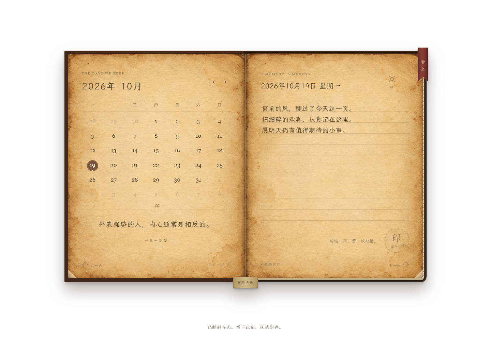
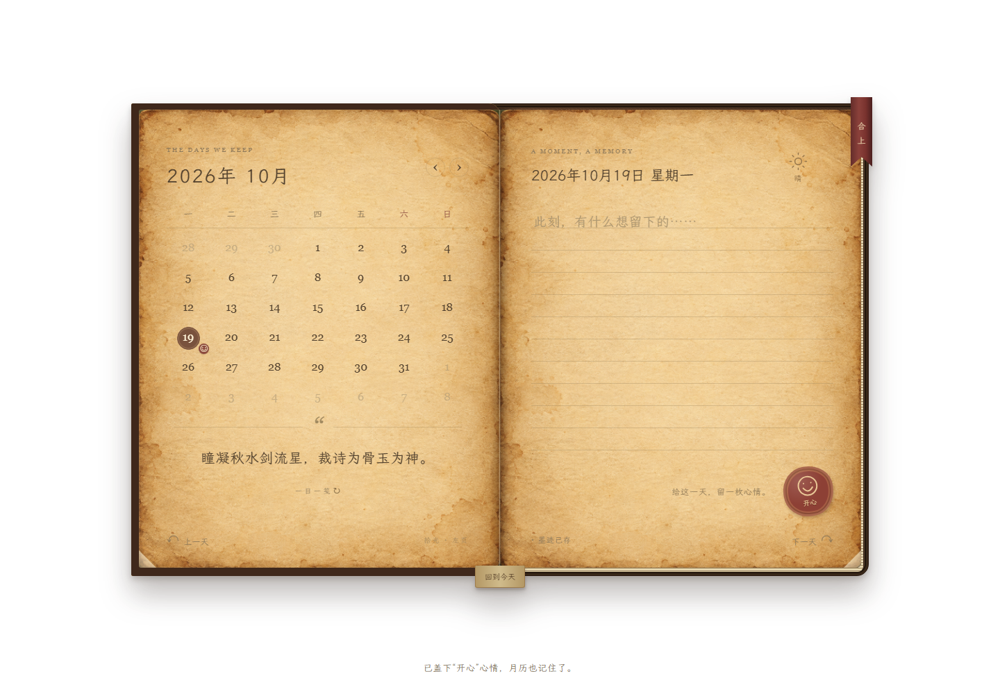

# 📖 拾页 · Daylore

<div align="center">
  
  <p><strong>Every day, a page worth keeping.</strong></p>
  <p>一本复古拟物的私人日记，把平凡日常收进书页里。</p>
  <p>Windows 桌面应用 · Tauri 2 · HTML / CSS / JavaScript</p>
</div>

## ✨ 核心体验

| 功能 | 说明 |
| --- | --- |
| 📖 复古书页 | 皮革封面、泛黄纸张，搭配开合、翻页动画与音效 |
| ✍️ 随手记录 | 停止输入后自动保存，也支持 `Ctrl+S` |
| 🗓️ 日历翻阅 | 按日期查看日记，一键回到今天 |
| 🌤️ 天气与心情 | 四种天气、六种心情印章，让每一天更鲜明 |
| 💌 一日一笺 | 随机短句相伴，网络不可用时自动使用本地寄语 |
| 🔒 本地保存 | 日记正文保存在本机，寄语请求不携带日记内容 |

## 🖼️ 界面展示

<table>
  <tr>
    <td align="center">
      <br />
      <sub>📖 轻触封面，拾起今天的一页</sub>
    </td>
    <td align="center">
      <br />
      <sub>✍️ 左页翻阅日历，右页记录日常</sub>
    </td>
    <td align="center">
      <br />
      <sub>💌 给这一天，留一枚心情</sub>
    </td>
  </tr>
</table>

## 🚀 本地运行

Windows 桌面开发需要 **Node.js 24、Rust、MSVC Build Tools 和 WebView2**。

```powershell
npm ci
npm run tauri -- dev
```

生成 Windows 安装程序：

```powershell
npm run tauri -- build
```

也可直接用浏览器打开 `index.html` 体验。桌面应用与浏览器中的日记数据分别保存在各自环境中。

## 💾 数据说明

日记使用本机 `localStorage` 保存。请保留应用数据；清理应用或浏览器的站点数据可能删除日记。

随机寄语会访问在线接口，请求不包含日记正文、日期或心情；网络不可用时仍可书写和翻阅日记。
